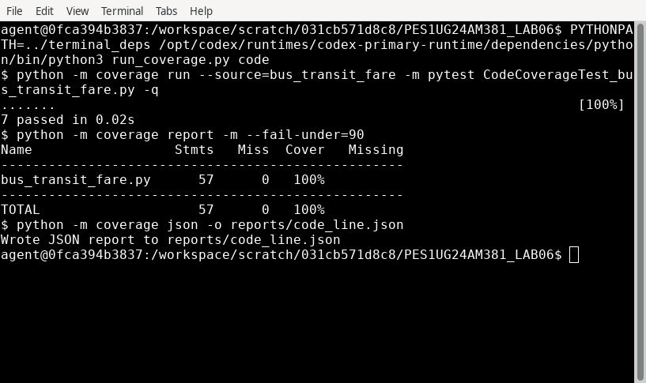
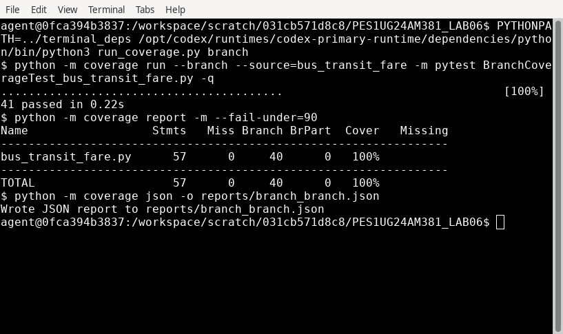

# Lab 6: Code and Branch Coverage Analysis

**Student:** Nishanth Nag M V  
**SRN:** PES1UG24AM381

Application: bus transit fare calculation and smartcard turnstile inspection.
Source: https://github.com/SETAPESU26/L6_L7_10_bus_transit_fare/tree/main/Lab%206

The supplied application and starter test are preserved. Only tests and supporting evidence are added.

## Results

| Stage | Tests passed | Statements | Branches | Combined coverage |
| --- | ---: | ---: | ---: | ---: |
| Original test | 1 | 28/57 (49.12%) | 16/40 (40%) | 45.36% |
| Code coverage suite | 7 | 57/57 (100%) | Not measured | 100% line coverage |
| Branch coverage suite | 41 | 57/57 (100%) | 40/40 (100%) | 100% |

Coverage is scoped to `bus_transit_fare.py`; test files are not included in the denominator. No application statements or branches are excluded.

## Reproduce

Run from this folder with Python 3.12:

```sh
python -m pip install -r requirements.txt
python run_coverage.py baseline
python run_coverage.py code
python run_coverage.py branch
python -m pytest -q
```

The runner prints the real coverage commands, exits on failure, and saves text and JSON reports in `reports/`. Improved stages enforce a minimum 90% coverage. Separate data files prevent one stage from contributing to another.

Equivalent direct commands:

```sh
python -m coverage run --source=bus_transit_fare -m pytest CodeCoverageTest_bus_transit_fare.py
python -m coverage report -m --fail-under=90
python -m coverage run --branch --source=bus_transit_fare -m pytest BranchCoverageTest_bus_transit_fare.py
python -m coverage report -m --fail-under=90
```

The capitalized deliverable filenames are explicitly included in `pytest.ini`, so ordinary pytest discovery runs them too.

## Coverage analysis

The original regular-local-ride test never reaches validation errors, alternate route rates, concessions, invalid zones, blacklists, priority fees, audit rejection, zero ridership, or either turnstile outcome.

The code suite exercises all 57 statements in both functions. Line coverage alone does not establish that every decision outcome or combination has been tested. The separate branch suite explicitly checks:

- Non-list input and a negative booking fee, including both ways the validation guard can reject input.
- Active and inactive routes, all three supported route types, unknown routes, and default field values.
- Regular, student, senior and fallback passenger types, with independently calculated expected fares.
- Zero and negative zones, continued processing after invalid commuters, and empty commuter lists.
- Blacklisted local/shuttle riders without cancellation of other riders.
- An express blacklist after an accepted rider: accumulated fare resets to zero and later riders are skipped. Priority fees still apply after the break, matching the supplied implementation.
- Priority boarding enabled/disabled, zero/positive fees, and fees on an empty manifest.
- Exactly four versus five rejections with a positive fare; audit rejection also takes precedence over zero ridership.
- Empty turnstile data, empty rows, threshold readings of 3 versus 4, one failure versus consecutive failures, reset after a healthy reading, and streak isolation between devices.

Branch coverage counts the control-flow arcs reported by coverage.py. It does not prove every possible path, MC/DC condition combination, input type, or business requirement is correct.

## Evidence

Only successful improved results have screenshots, as requested by the handout. Initial results are retained as text and JSON.





## Deliverables and commits

- `CodeCoverageTest_bus_transit_fare.py`: 7 code coverage cases.
- `BranchCoverageTest_bus_transit_fare.py`: 41 branch and boundary cases.
- `screenshots/`: actual terminal captures after achieving 100% coverage.
- `reports/`: captured output and machine-readable coverage evidence.
- Separate code coverage and branch coverage commits.
